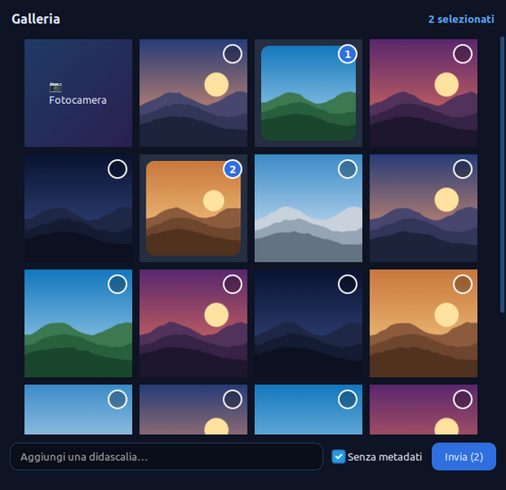
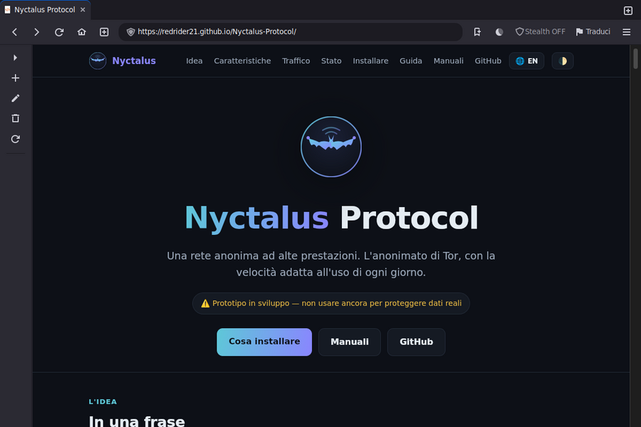
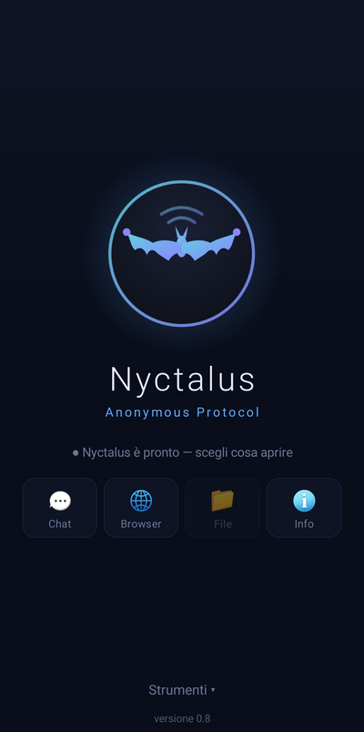
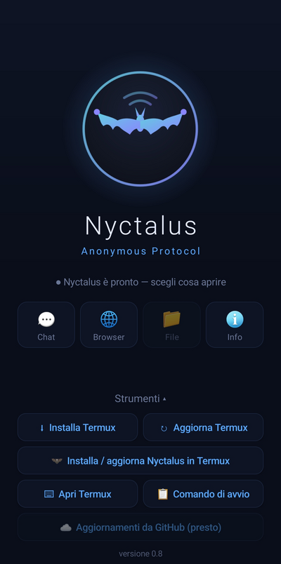
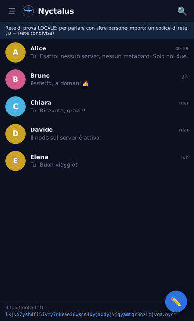

<!-- SPDX-License-Identifier: AGPL-3.0-or-later -->
<!-- Copyright (C) 2026 Daniele Deplano (RedRider21). Parte di Nyctalus Protocol. -->

<p align="center"></p>

# Nyctalus Protocol

**Una rete anonima ad alte prestazioni: l'anonimato di Tor, con la velocità adatta all'uso di ogni giorno.**

> ⚠️ **Stato: prototipo in sviluppo.** Il codice funziona ed è testato, ma il
> protocollo non è ancora completo né verificato da revisori indipendenti.
> **Non usarlo ancora per proteggere dati reali.**

Sito e manuale: **https://redrider21.github.io/Nyctalus-Protocol/**

---

## Come appare

<sub>Screenshot su dati dimostrativi (contatti e foto inventati). Si rifanno con <code>strumenti/crea-screenshot.sh</code>.</sub>

### Sul PC (Linux)

<p align="center">
  <br>
  <sub><b>Mini menu da desktop</b>: logo (sito e manuali), Browser, Chat, Rubrica, File (in arrivo), impostazioni</sub>
</p>

<p align="center">
  <br>
  <sub><b>Chat <code>.nyct</code></b> in stile Telegram: senza server e senza metadati, con foto, video, audio e file</sub>
</p>

<table align="center"><tr>
<td align="center" width="50%"><br><sub><b>Allegati</b>: galleria con selezione numerata, didascalia, foto senza metadati</sub></td>
<td align="center" width="50%"><br><sub><b>Browser</b>: navigazione normale o <b>Stealth</b> (rete Nyctalus), siti <code>.nyct</code></sub></td>
</tr></table>

### Sul telefono (Android)

<table align="center"><tr>
<td align="center"><br><sub><b>App Nyctalus</b>: Chat, Browser, File, Info</sub></td>
<td align="center"><br><sub><b>Strumenti</b>: Termux e installazione di Nyctalus</sub></td>
</tr></table>

<table align="center"><tr>
<td align="center"><br><sub>Elenco delle chat</sub></td>
<td align="center"><br><sub>Conversazione</sub></td>
<td align="center"><br><sub>Galleria degli allegati</sub></td>
<td align="center"><br><sub>Temi, rete, codice di rete</sub></td>
</tr></table>

<sub>L'app Android (APK) avvia Nyctalus in Termux e apre Chat, Rubrica della rete, Browser (con modalità 🦇 Nyctalus) e manuali. Come installare: <a href="documenti/manuali/SCELTE-OPERATIVE.md">Scelte operative</a>.</sub>

---

## L'idea in una frase

Ogni utente è anche un nodo, così la rete diventa più veloce man mano che cresce.
Il traffico è camuffato da normale navigazione, e i dati viaggiano spezzati in
tanti frammenti su molte strade in parallelo — una **ragnatela** — per
ricomporsi solo a destinazione.

## Perché, se c'è già Tor

Tor funziona, ma è lento per ragioni strutturali. Nyctalus cambia le scelte di
fondo per guadagnare velocità senza rinunciare all'anonimato:

| | Tor | Nyctalus |
|---|---|---|
| Chi fa da nodo | ~7.000 volontari per milioni di utenti | ogni PC è anche un nodo: più utenti, più capacità |
| Strade per i dati | un solo percorso per connessione | ragnatela: più percorsi in parallelo dopo un ingresso fisso |
| Trasporto | TCP (un pacchetto perso blocca gli altri) | QUIC/UDP (un pacchetto perso non ferma il resto) |
| Camuffamento | opzionale (bridge) | sempre attivo, di serie |
| Siti interni | `.onion` | `.nyct`, con percorsi paralleli |
| Linguaggio | C (Tor classico) | Rust (niente bug di memoria) |

## Come viaggia un dato

```
                       ┌──► nodo ──► nodo ──┐
 Tu ──► [INGRESSO] ────┼──► nodo ──► nodo ──┼──► RICOMPOSIZIONE ──► destinazione
       (fisso per      ├──► nodo ──► nodo ──┤    (uscita verso Internet
        settimane)     └──► nodo ──► nodo ──┘     oppure sito interno .nyct)
```

1. **Camuffamento:** il traffico sembra una normale connessione HTTPS (QUIC su UDP 443).
2. **Ingresso fisso:** il primo nodo resta lo stesso per settimane; è l'unico che vede il tuo IP, ma non sa dove vai.
3. **Ragnatela:** i dati, spezzati in frammenti, viaggiano in parallelo su più strade.
4. **Cipolla:** ogni frammento è chiuso in più strati; ogni nodo ne toglie uno e scopre solo il nodo successivo.
5. **Ricomposizione:** a destinazione i frammenti tornano in ordine.

## Protezione dall'analisi del traffico: celle a lunghezza fissa e rumore di fondo

Nascondere *dove* vai non basta: chi osserva la rete può provare a dedurre
*cosa* fai dalla **forma** del traffico — la dimensione dei pacchetti e i loro
tempi. Nyctalus appiattisce entrambe.

### Celle a lunghezza fissa

Dentro un circuito, i dati non viaggiano come pacchetti di lunghezza variabile,
ma spezzati in **celle tutte della stessa dimensione** (`motore/nyctalus/src/cella.rs`):

```
┌─────────┬─────────┬────────────┬───────────────┬──────────────────────┐
│ flusso  │ comando │ lunghezza  │ dati (reali)  │  riempimento a zero   │
│  2 B    │  1 B    │   2 B      │   0…1359 B    │  fino a lunghezza fissa│
└─────────┴─────────┴────────────┴───────────────┴──────────────────────┘
        intestazione (5 B)              CAPACITA = 1359 B
```

La taglia è scelta apposta: un'**unità dati** sul filo (sequenza + cella) è
**1372 byte**, esattamente come il **pacchetto di apertura Sphinx** — così
nemmeno il primo quadro del circuito si distingue per dimensione. La lunghezza
reale dei dati sta in un **campo interno**; il resto è riempimento a zero.
Conseguenze:

- **Un osservatore non deduce la lunghezza dei contenuti:** una risposta di 1 byte
  e una di 1359 occupano lo stesso numero di celle della stessa dimensione.
- Poiché il riempimento è *dentro* lo strato cifrato, i nodi intermedi vedono
  solo celle identiche per dimensione a ogni tratta (lo strato a cipolla, ChaCha20,
  non cambia la lunghezza).
- **È la condizione necessaria** perché il rumore di fondo funzioni: una cella
  finta dev'essere indistinguibile da una vera, e lo è solo se hanno la stessa forma.

Il prezzo è un po' di banda sprecata nel riempimento (il compromesso classico,
come i 514 byte delle celle di Tor).

### Rumore di fondo (cover traffic)

Con l'opzione `--cover HZ` si iniettano **celle fittizie** (comando
`RIEMPIMENTO`) a **ritmo di Poisson**, indistinguibili dalle vere e **scartate**
dall'altro estremo. Funziona in **entrambe le direzioni**: in salita sul demone
(`circuit/start --cover`) e in discesa sul nodo d'uscita (`node --cover`).
Mascherano **quando** si invia davvero: un osservatore vede un flusso di celle
uniforme sia che tu stia caricando una pagina sia che tu sia fermo.

```sh
nyctalus circuit … --cover 5      # ~5 celle finte/s in salita; default 0 (spento)
nyctalus node    … --cover 5      # ~5 celle finte/s in discesa
```

Il traffico che il tuo nodo inoltra per conto di altri utenti funge già da
**copertura naturale** aggiuntiva.

### Camuffamento del trasporto

Sul filo, ogni datagramma UDP può essere avvolto (ChaCha20 + nonce per
datagramma, opzione `--obfuscation`): per un DPI è rumore casuale, senza la firma
di QUIC. Così la rete non si riconosce nemmeno a livello di collegamento.

Tutti i quadri del circuito e del rendezvous — dati, LINK, **pacchetto di
apertura Sphinx** e tunnel `.nyct` — hanno ora la **stessa taglia** (1372 byte).
**Limite rimasto:** il ritmo del cover va **tarato con misure reali** (costo in
banda contro beneficio), cosa che richiede una rete di nodi vera. Vedi
[STATO.md](documenti/STATO.md) §H.

## Architettura a livelli

| Livello | Cosa fa | Stato |
|---|---|---|
| **L3 Applicazione** | proxy SOCKS5 locale · siti interni `.nyct` · browser · chat · launcher | ✅ |
| **L2 Flusso** | etichette segrete + cifratura end-to-end + ricomposizione | ✅ |
| **L1 Cipolla** | apertura circuito (Sphinx) + strati simmetrici · celle a lunghezza fissa | ✅ |
| **L0 Collegamento** | QUIC tra nodi, camuffato (offuscamento ChaCha20) | ✅ |

## A che punto siamo

**Fatto e testato** (95 test automatici):
- **L2 — nucleo del protocollo:** frammentazione, etichette segrete rotanti (BLAKE3), cifratura end-to-end (ChaCha20-Poly1305) con pacchetti di lunghezza fissa, ricomposizione con limiti anti-DoS.
- **Stretta di mano Noise NK:** i due estremi si accordano sul segreto senza farlo mai viaggiare; forward secrecy; il mittente resta anonimo.
- **Indirizzi `.nyct`:** la chiave pubblica di un servizio in base32, con controllo anti-errori di battitura.
- **L1 — livello a cipolla (data-plane):** gli strati simmetrici che ogni pacchetto attraversa.
- **CLI (comandi in inglese):** demone `nyctalus start` (SOCKS5 da configurazione, ragnatela conflux), `nyctalus status` e `nyctalus nodes` (elenco dei nodi, con `--probe` per vedere quali sono raggiungibili ora e il loro tempo di risposta); comandi di test `circuit`, `node`, `directory`, `authority`.
- **Elenco firmato dei nodi** (directory, autorità Ed25519) e **autenticazione dei collegamenti**: il client pinna il guard, ogni relè pinna il nodo a valle con l'impronta presa dall'elenco firmato.
- **Circuito condiviso**: un solo circuito trasporta più connessioni, multiplexate con celle dentro gli strati a cipolla (i relè restano ciechi ai singoli flussi).
- **Ponte verso i `.onion` di Tor**: l'uscita riconosce gli indirizzi `.onion` e li raggiunge attraverso un Tor già presente sul sistema (proxy SOCKS, `--tor-socks`, default `127.0.0.1:9050`); i siti normali vanno in TCP diretto.
- **Camuffamento del trasporto**: con una chiave di rete, ogni datagramma UDP è offuscato (ChaCha20): sul filo appare rumore casuale, senza la firma di QUIC riconoscibile da un DPI. Opzione `--obfuscation` / `obfuscation` nel config.
- **Ragnatela (conflux)**: un singolo scaricamento viene **spezzato su più circuiti** (guard e uscita condivisi, intermedi diversi) e **ricomposto a destinazione** grazie a una sequenza end-to-end dentro l'onion — così sfrutta la banda di più strade.
- **Anti-correlazione**: il numero di sequenza non viaggia in chiaro (nonce da contatore locale per direzione).
- **Siti interni `.nyct`**: `site` ospita una cartella come sito `.nyct`, `browse` lo visita, e il **browser** li apre dal proxy SOCKS. Servizio e client si incontrano a un **nodo punto d'incontro** che fa solo da ponte opaco; fra loro c'è una sessione **Noise NK end-to-end** (l'indirizzo `.nyct` *è* la chiave del servizio) con HTTP sopra. Il punto d'incontro si **sceglie da solo** (deterministico dall'indirizzo e dall'elenco firmato, con rotazione) e lo si raggiunge con un **circuito a più salti**: così nemmeno quel nodo conosce gli IP di sito e visitatore — vede solo l'ultimo relè.

- **Rumore di fondo (cover traffic) + celle a lunghezza fissa**: tutti i quadri del circuito e del rendezvous hanno la **stessa taglia** (1372 byte); celle fittizie opzionali (`--cover`) in **entrambe le direzioni** mascherano *quando* si invia.
- **Browser dedicato** (clone di Firefox): parte normale, lo **stealth** (rete Nyctalus) si accende col bottone e **avvia da solo i servizi** (rete pubblica configurata o rete di prova locale); i `.nyct` attivano lo stealth automaticamente.
- **Chat `.nyct`** (senza server, senza metadati): ogni utente è un indirizzo `.nyct` (il suo Contact ID); motore in Rust (`nyctalus chat`) + finestra GTK. Oltre all'anonimato di rete e alla cifratura E2E, **chi scrive è autenticato crittograficamente** (un secondo handshake Noise NK dentro il tunnel: solo chi possiede la chiave privata dell'indirizzo dichiarato lo conclude), quindi nessuno può spacciarsi per un contatto. Grafica in **stile Telegram** con temi e sfondi, **menu del tasto destro** e **allegati di ogni tipo** come in Telegram (foto e video a tutta bolla, audio ascoltabile nella chat, documenti, **foto e video dalla webcam**; verifica d'integrità BLAKE3, foto inviate senza EXIF), **emoticon**, **in linea / ultimo accesso** e la **rubrica della rete** 👥 (ci si iscrive con un nome, si vede chi usa la rete e chi è in linea, si aggiunge con un clic), **notifiche** dei nuovi messaggi (sul telefono anche ad app chiusa, senza Google) le **spunte** come Telegram (✓ spedito, ✓✓ consegnato, ✓✓ blu letto) e la **casella cifrata** 📮 per scrivere a chi non è in linea (solo il destinatario può leggere, la casella non sa chi scrive). Guida: [MANUALE-CHAT.md](documenti/manuali/MANUALE-CHAT.md).
- **Siti `.nyct` con un comando** (`nyctalus-sito`): pagine fisse o un sito dinamico dietro un server web locale, messi online sulla rete Nyctalus (anche sempre accesi come servizio), senza rivelare dove stanno. Guida: [MANUALE-SITI.md](documenti/manuali/MANUALE-SITI.md).
- **Mini-launcher da desktop**: pannello senza bordi, trascinabile, con bottoni quadrati (orizzontale/verticale), **dimensione regolabile** e **tasti rapidi configurabili**, per lanciare Browser, Chat e Rubrica. Client grafici (browser, launcher, chat) in **Python+GTK3**; il motore resta in **Rust**.

**In arrivo** (vedi [STATO.md](documenti/STATO.md)): taratura del rumore di fondo su rete reale, rotazione dei guard e ripresa dai circuiti caduti, descrittore firmato dei servizi, simulazione contro Tor con **Shadow**, gestore file grafico, **versione mobile** (PWA servita dal motore in Termux, browser mobile dal clone Chrome di NovaOS).

## Come è organizzato il progetto

```
nyctalus protocol/
├── motore/          il motore in Rust: nyctalus-core (protocollo) + nyctalus (demone, nodi, chat)
├── pc/              i programmi per il computer (Python+GTK3): browser/, chat/, launcher/,
│                    gestore-rete/ (nyctalus-rete: codice di rete, rete di casa, gestione)
├── server/          i nodi su un server: installatore (servizi systemd) e nyctalus-server
├── mobile/          il telefono: orchestratore/ (Python in Termux), webapp/ (PWA),
│                    termux/ (installatore), android/ (APK)
├── strumenti/       script di sviluppo: demo, avvio della chat, creazione delle installazioni
├── test/            tutte le prove di funzionamento e di sicurezza: test/esegui-tutti.sh
├── documenti/       visione, specifica, stato dei lavori, deploy, sicurezza, manuali
└── installazioni/   GENERATA da strumenti/crea-installazioni.sh: cosa installare e dove
    ├── PC-Linux/    archivio pronto + istruzioni (l'installatore chiede: client, gestore o nodo)
    ├── Server-Linux/ solo il motore, per i nodi su un VPS
    └── Android/     archivio per Termux + APK + istruzioni passo-passo
```

## Compilare

Serve [Rust](https://rustup.rs) (profilo minimal sufficiente):

```sh
cargo test              # 95 test
cargo build --release   # produce target/release/nyctalus
```

`cargo clean` svuota la cartella `target/` se serve spazio.

## Uso da terminale

Nyctalus è, come Tor, un demone con interfaccia a riga di comando (in inglese);
il browser è solo uno dei client. I comandi (`start`, `status`, `nodes`, `site`,
`browse`, `monitor`, `exec`, `node`, `authority`, `directory`, …) sono elencati
da `nyctalus help`. Per **installare, configurare e mettere in piedi una rete**
vedi **[DEPLOY.md](documenti/DEPLOY.md)**; per **verificare** sicurezza e anonimato
**[SICUREZZA.md](documenti/SICUREZZA.md)**. Esempi:

### Proxy SOCKS5 (un salto — non ancora anonimo)

Sul nodo di uscita:
```sh
nyctalus exit --listen 0.0.0.0:4600
```
Stampa il comando `single-hop` completo, con l'impronta del certificato. Sul client:
```sh
nyctalus single-hop --to IP-USCITA:4600 --fingerprint <FINGERPRINT> --socks 127.0.0.1:1080
curl --socks5-hostname 127.0.0.1:1080 https://example.com
```

> Questo è un **solo salto** (client → uscita): serve a rendere la CLI usabile
> subito. L'uscita vede l'IP del client: **non è ancora anonimo**. I nodi
> intermedi e la cipolla lo trasformeranno in un percorso anonimo.

### Circuito anonimo a 3 salti (autenticato)

```sh
# 1) crea un'autorità per firmare l'elenco dei nodi
nyctalus authority                      # stampa segreto + pubblica

# 2) avvia i nodi (stampano la loro riga per l'elenco)
nyctalus node --listen 0.0.0.0:4601 --directory directory.txt --authority <PUB>
nyctalus node --listen 0.0.0.0:4602 --directory directory.txt --authority <PUB>
nyctalus node --listen 0.0.0.0:4603 --directory directory.txt --authority <PUB>

# 3) firma l'elenco con le righe stampate dai nodi
nyctalus directory --authority-secret <SECRET> \
  --entries 'addr,x,fp;addr,x,fp;addr,x,fp' > directory.txt

# 4) proxy SOCKS5 attraverso il circuito a 3 salti
nyctalus circuit --directory directory.txt --authority <PUB> --socks 127.0.0.1:1080 \
  --circuits 2 --hops 3
curl --socks5-hostname 127.0.0.1:1080 http://example.com
```

Con l'elenco firmato ogni collegamento è autenticato: un elenco manomesso o
firmato da un'autorità diversa viene rifiutato.

### Demone da configurazione

Invece di passare tutto a riga di comando, si può usare un file
`~/.config/nyctalus/config`:

```ini
directory = /percorso/directory.txt
authority = <PUB>
socks     = 127.0.0.1:1080
circuits  = 2
hops      = 3
```

```sh
nyctalus status     # mostra la configurazione e valida l'elenco
nyctalus start      # avvia il proxy SOCKS5 attraverso la ragnatela conflux
```

### Elenco dei nodi e scelta del target

```sh
nyctalus nodes                      # elenco firmato dei nodi (indirizzo, chiave, impronta)
nyctalus nodes --probe              # + verifica quali sono raggiungibili ora, con il tempo di risposta
nyctalus nodes --probe --timeout 2  # tempo massimo di attesa per nodo (secondi)
```

`nodes` legge `directory`/`authority` dal config (o da `--directory`/`--authority`).
Senza `--probe` non contatta nessuno: mostra solo l'elenco. Con `--probe` apre
verso ogni nodo la stessa connessione QUIC autenticata di un circuito e segna
`online`/`offline`. I valori `address` e `fingerprint` stampati si incollano
direttamente in `single-hop`, `send` o `circuit` per **scegliere un target**.

### Programmi e monitoraggio

```sh
# lancia un programma instradandone il traffico nella rete (stile torsocks)
nyctalus exec -- curl https://example.com
nyctalus exec --socks 127.0.0.1:1080 -- git clone https://…

# cruscotto testuale con le metriche del demone (stile nyx), aggiornato ogni secondo
nyctalus monitor --control 127.0.0.1:1090
```

`exec` funziona con i programmi che rispettano le variabili `ALL_PROXY`/`http_proxy` (curl, git, wget…); il demone pubblica le metriche sulla porta di controllo (`--control`, default `127.0.0.1:1090`).

**Impostazioni del percorso:**
- `--circuits N` (o `circuits` nel config) — strade parallele usate contemporaneamente. **Minimo 1, massimo 8**, default **2**.
- `--hops N` (o `hops`) — nodi per percorso (guard + intermedi + uscita). **Minimo 1, massimo 5** (limite di Sphinx), default **3**. Sotto i 3 salti non c'è vero anonimato.
- `--cover HZ` (o `cover`) — **rumore di fondo**: celle fittizie (indistinguibili dalle vere, perché tutte le celle hanno lunghezza fissa) iniettate a ritmo di Poisson per mascherare *quando* invii davvero. Default **0** (spento); un valore basso (es. `5`) è un compromesso fra copertura e banda.

**Affidabilità:** il trasporto è QUIC (su UDP), che **recupera da solo i pacchetti persi** e li riconsegna in ordine; un pacchetto perso non blocca gli altri flussi (niente head-of-line blocking fra flussi).

### Siti interni `.nyct`

Un nodo fa da **punto d'incontro**; il sito vi si registra e il visitatore vi si
collega. Il nodo fa solo da ponte: fra sito e visitatore c'è una sessione
cifrata end-to-end, e nessuno dei due conosce l'IP dell'altro.

Con un elenco firmato dei nodi, il punto d'incontro si **sceglie da solo** (non
serve indicarlo): sito e visitatore lo ricavano dall'indirizzo `.nyct` e
dall'elenco, in modo deterministico.

```sh
# pubblica una cartella come sito .nyct (stampa l'indirizzo <ADDR>.nyct)
nyctalus site --dir ./mio-sito --identity sito.key --directory directory.txt --authority <PUB>

# visita il sito (HTML, CSS, JS, immagini…) — nessun punto d'incontro da indicare
nyctalus browse <ADDR>.nyct --directory directory.txt --authority <PUB>
nyctalus browse <ADDR>.nyct --path /pagina.html --directory directory.txt --authority <PUB>
```

Sito e visitatore raggiungono il punto d'incontro con un **circuito a più salti**
(`--hops`, default 3), come l'uscita verso Internet: così nemmeno quel nodo
conosce gli IP di sito e visitatore — vede solo l'ultimo relè. Il punto
d'incontro **ruota nel tempo** (cambia con il giorno). Lo si può forzare a mano,
in modo diretto a salto singolo, con `--rendezvous IP:PORT --fingerprint <FP>`
(utile per prove con un solo nodo).

I siti `.nyct` sono normali pagine **HTML5 + JavaScript**: una cartella di file
servita dal sito. In alternativa, con `site --backend IP:PORT` il demone fa da
proxy a un **web server esistente** (Nginx, Apache…), che gestisce lui tutto
l'HTTP:

```sh
nyctalus site --backend 127.0.0.1:8080 --directory directory.txt --authority <PUB>
```

**Dal browser.** Il demone SOCKS (`start`/`circuit`) riconosce gli host `.nyct` e
li instrada al punto d'incontro invece che all'uscita: basta puntare il browser
(o `curl`) al proxy SOCKS e aprire `http://<ADDR>.nyct`.

```sh
nyctalus circuit --directory directory.txt --authority <PUB> --socks 127.0.0.1:1080 --hops 3
curl --socks5-hostname 127.0.0.1:1080 http://<ADDR>.nyct/
```

### Trasferimento di un file (test del livello L2)

Sul ricevitore:
```sh
nyctalus receive --out received.bin --identity my.key
```
Stampa il comando `invia` con l'indirizzo `.nyct` del ricevitore. Sul mittente:
```sh
nyctalus send --to IP:4433 --fingerprint <FINGERPRINT> --recipient <ADDRESS>.nyct file
```

### Client grafici (browser, chat, launcher)

I client grafici sono in Python+GTK3 e stanno in `pc/browser/`, `pc/chat/`, `pc/launcher/`.
```sh
./strumenti/demo-locale.sh     # browser stealth su un sito .nyct di prova
./strumenti/demo-chat.sh       # chat: due finestre (due identità) in locale
./pc/launcher/nyctalus-launcher # il pannello da cui lanci browser e chat
```
Per l'uso reale (rete condivisa) usa `avvia-chat.sh`; la guida passo-passo della
chat è in [MANUALE-CHAT.md](documenti/manuali/MANUALE-CHAT.md). Dentro la chat, il pulsante **?**
apre il manuale nel browser.

## Cosa promette e cosa no

**Protegge da:** provider Internet e reti Wi-Fi, tracciamento e profilazione,
censura e blocchi, siti che vogliono il tuo IP, singoli nodi malevoli.

**Non promette:** protezione totale contro chi sorveglia contemporaneamente
gran parte di Internet — contro un avversario simile nessuna rete veloce può
farlo, e su questo la protezione sarà pari a Tor, non superiore. E non protegge
chi si identifica da solo (login, dati personali).

## Documenti

- [VISIONE.md](documenti/VISIONE.md) — l'idea, le scelte, il percorso verso il protocollo di riferimento
- [SPECIFICA.md](documenti/SPECIFICA.md) — modello di minaccia, livelli, formati dei pacchetti
- [STATO.md](documenti/STATO.md) — punto dei lavori e cose da fare
- [DEPLOY.md](documenti/DEPLOY.md) — installare, configurare, mettere in piedi una rete, opzioni
- [SICUREZZA.md](documenti/SICUREZZA.md) — come verificare sicurezza e anonimato (e cosa serve un audit)

## Il nome

Dal genere *Nyctalus*, le nottole: pipistrelli che volano veloci di notte e si
orientano al buio. Dal greco *nyx*, notte.

## Licenza

[AGPL-3.0-or-later](LICENSE). © 2026 Daniele Deplano (RedRider21).
